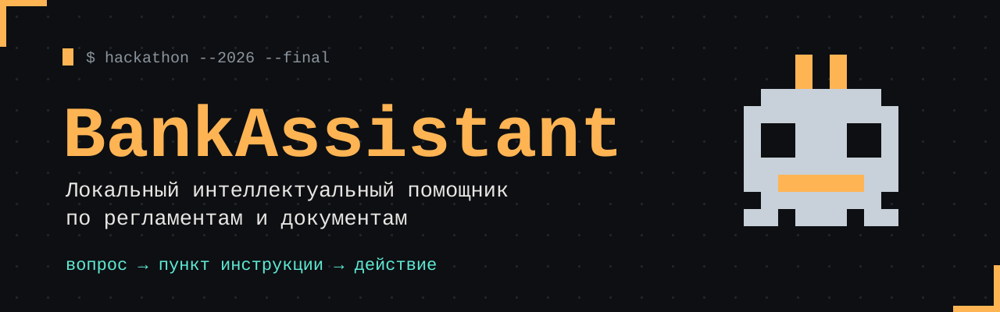
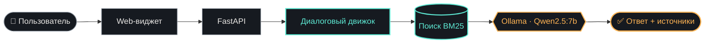

<div align="center">



<br>


**[▶ Видеодемо](https://rutube.ru/video/25d672f5716cb535a2fe046a474392a9/)** &nbsp;·&nbsp; **[Возможности](#-возможности)** &nbsp;·&nbsp; **[Архитектура](#-как-это-работает)** &nbsp;·&nbsp; **[Быстрый старт](#-быстрый-старт)**

</div>

<br>

## 👾 О проекте

> Нормативные формулировки сложно искать и понимать вручную: время уходит на поиск, а не на работу.

**BankAssistant** находит основание в Инструкции, объясняет его простым языком и превращает ответ в конкретное действие — готовый документ.

<table>
<tr>
<td align="center" width="33%"><h3>⚡ секунды</h3>ответ по регламенту<br>с пунктом и источником</td>
<td align="center" width="33%"><h3>📄 минута</h3>готовый Word-документ<br>по шаблону</td>
<td align="center" width="33%"><h3>🔒 локально</h3>данные не покидают<br>корпоративный контур</td>
</tr>
</table>

<br>

## 🕹 Возможности

<table>
<tr>
<td width="50%" valign="top">

**💬 Диалог по Инструкции**<br>
Ответ с пунктом, версией документа и процентом релевантности.

</td>
<td width="50%" valign="top">

**🗣 Понимает обычный язык**<br>
Исправляет опечатки: «скока дней согласование».

</td>
</tr>
<tr>
<td valign="top">

**🛡 Безопасный отказ**<br>
Не выдумывает курсы, тарифы и персональные данные.

</td>
<td valign="top">

**🏦 Общий банковский режим**<br>
Справка по овердрафту, переводам, картам — отдельно от внутренних правил.

</td>
</tr>
<tr>
<td valign="top">

**📝 Формирование документов**<br>
Служебная записка, заявление, акт, распоряжение, проект поручения → DOCX.

</td>
<td valign="top">

**🔎 Проверка черновиков**<br>
PDF / DOCX / TXT / MD → процент соответствия Инструкции и рекомендации.

</td>
</tr>
</table>

<sub>Также: ролевая модель доступа · версионность базы знаний (старые версии уходят в архив) · обратная связь «Да / Нет» с локальной памятью исправлений.</sub>

<br>

## 🧩 Как это работает



**RAG-цепочка:** фрагменты базы знаний → контекст модели → проверка ссылок на пункты → ответ. Модель отвечает только по найденному, а ссылки на пункты проверяются перед выдачей.

<br>

## 🧱 Технологический стек

| Слой | Технологии |
|:---|:---|
| 🎨 **Frontend** | HTML · CSS · JavaScript, виджет на Shadow DOM, страницы чата, Wiki и настроек |
| ⚙️ **Backend** | Python · FastAPI · Uvicorn |
| 🔍 **Поиск** | Локальный BM25 по пунктам, фильтр по роли, порог релевантности |
| 🧠 **LLM** | Ollama + Qwen2.5:7b (локально) |
| 📄 **Документы** | python-docx · docxtpl · Word-шаблоны |
| 🐳 **Деплой** | Docker Compose · Caddy (reverse proxy) |

<br>

## 🚀 Быстрый старт

```bash
# 1. клонируем репозиторий
git clone https://github.com/tokseed/OllaSup.git
cd OllaSup

# 2. скачиваем модель (веса в Git не хранятся)
ollama pull qwen2.5:7b

# 3. запускаем
docker compose up -d
```

> [!NOTE]
> В контейнере приложение обращается к Ollama по адресу сервиса или `host.docker.internal`, а не к `localhost`.

<br>

## 🎬 Демо-сценарий за 3 минуты

| ⏱ | Что показываем |
|:---:|:---|
| `0:15` | «Сколько дней на согласование?» → пункт 3.4 |
| `1:00` | Опечатка: «скока дней согласование» |
| `1:15` | «Курс доллара?» → бот не выдумывает |
| `1:35` | «Что такое овердрафт?» — общий режим |
| `2:25` | Служебная записка → DOCX |
| `2:45` | Проверка черновика → % соответствия |

<br>

## ⚠️ Честно об ограничениях

> [!WARNING]
> Это прототип хакатона. Перед внедрением нужна доработка.

- Поиск лексический (BM25), не векторный
- Обратная связь — память исправлений, **не** дообучение Qwen
- Сессии хранятся в памяти процесса
- Демо-шаблоны должны быть проверены ответственным подразделением
- Общие банковские ответы не заменяют официальные данные банка

## 🗺 Roadmap

- [ ] Векторный поиск + reranking
- [ ] Redis для нескольких воркеров
- [ ] GPU и постоянное хранилище
- [ ] Новые инструкции, процессы и шаблоны

<br>

<div align="center">

`ответ по регламенту за секунды · документ за минуту`

<sub>Сделано на хакатоне 2026 · <a href="https://rutube.ru/video/25d672f5716cb535a2fe046a474392a9/">смотреть видеодемо</a></sub>

</div>
